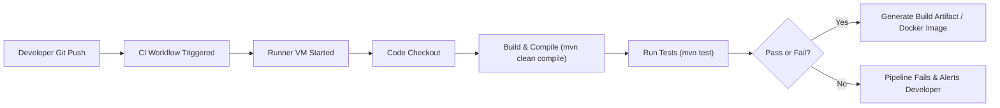
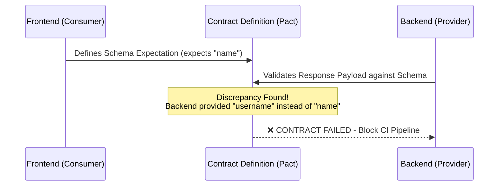
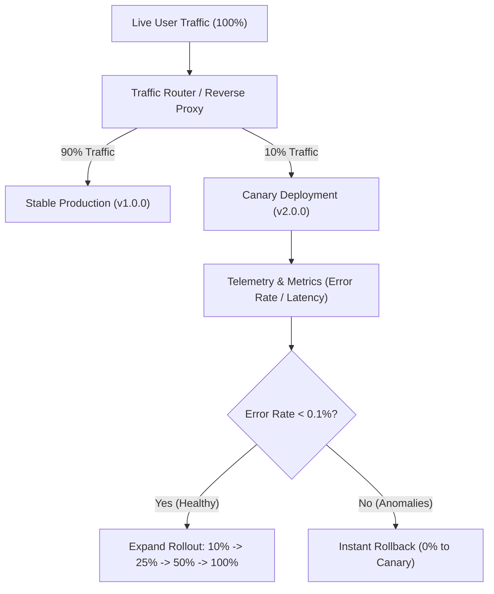
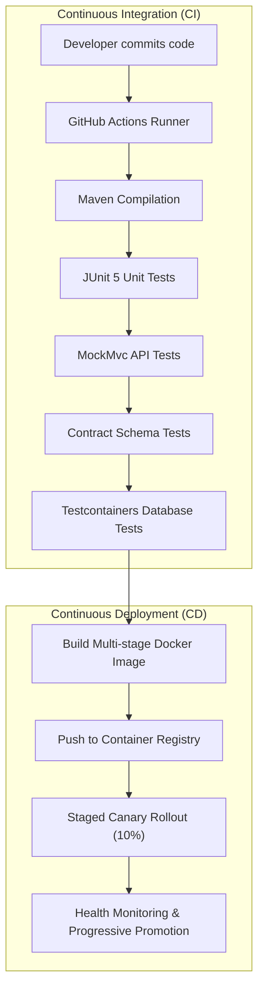

# Experiment 9: CI/CD Pipeline with Testing & Deployment 🚀

*Unit 3 — Advanced Software Engineering & DevOps Architecture*

---

## 📋 Table of Contents
1. [Overview & Aim](#1-overview--aim)
2. [Continuous Integration (CI)](#2-continuous-integration-ci)
3. [Continuous Deployment (CD)](#3-continuous-deployment-cd)
4. [Unit Testing with JUnit 5](#4-unit-testing-with-junit-5)
5. [Integration Testing with MockMvc](#5-integration-testing-with-mockmvc)
6. [Contract Testing (Pact & Consumer-Driven Contracts)](#6-contract-testing-pact--consumer-driven-contracts)
7. [Real Infrastructure Testing with Testcontainers](#7-real-infrastructure-testing-with-testcontainers)
8. [Docker & Containerization](#8-docker--containerization)
9. [Automation with GitHub Actions](#9-automation-with-github-actions)
10. [Canary Deployment Strategy](#10-canary-deployment-strategy)
11. [End-to-End Pipeline Architecture Diagram](#11-end-to-end-pipeline-architecture-diagram)
12. [Lab Assignments Walkthrough (Assignments 1 – 5)](#12-lab-assignments-walkthrough-assignments-1--5)
13. [Key Takeaways & Future Scope](#13-key-takeaways--future-scope)

---

## 1. Overview & Aim

### Aim
Build a complete **CI/CD pipeline** that includes automated testing, containerized environments, contract validation, and staged deployment strategies.

### The Problem in Traditional Software Engineering
In conventional development lifecycles:
- Code is merged manually, often right before a release ("Merge Hell").
- Testing is performed manually by QA engineers, leading to slow turnaround times and human error.
- Environments differ significantly between developer laptops and production servers ("*It works on my machine!*").
- Big-bang deployments expose 100% of end-users to potential bugs at once.

### The Solution: Automated CI/CD
Modern DevOps organizations replace manual bottlenecks with automated pipelines that validate every commit, package applications in immutable containers, and safely release features using progressive rollout strategies like **Canary Deployments**.

---

## 2. Continuous Integration (CI)

### What is CI?
**Continuous Integration (CI)** is the engineering practice where software developers frequently merge code changes into a central repository (e.g., GitHub, GitLab). Each push triggers an automated build and automated test suite.



### How CI Works (Step-by-Step)
1. **Push:** Developer commits and pushes changes to the `main` branch.
2. **Trigger:** The CI system (e.g., GitHub Actions) detects the push event via webhooks.
3. **Runner Spawn:** A clean virtual machine or container runner spins up (`ubuntu-latest`).
4. **Checkout:** The repository code is cloned onto the runner.
5. **Compilation:** Build tool executes (`mvn clean compile` or `./gradlew build`).
6. **Test Suite Execution:** Unit tests, integration tests, and static analysis execute in parallel.
7. **Result:**
   - If **all tests pass**, the build is marked green and passes to the CD stage.
   - If **any test fails**, the pipeline halts immediately, preventing defective code from progressing.

### Why is CI Important?
- **Detect Bugs Early:** Bugs caught during commit time cost 10x to 100x less to fix than in production.
- **Ensure Code Quality:** Enforces formatting, code coverage, and static security scans.
- **Eliminate Integration Issues:** Small, continuous merges prevent painful end-of-sprint merges.

### When to Use?
- Multi-developer teams working on shared codebases.
- Microservice and cloud-native applications with frequent daily commits.

### Pros & Cons
| Advantages | Drawbacks |
| :--- | :--- |
| Instant feedback loop for developers | Initial pipeline configuration overhead |
| Massive reduction in regression bugs | Requires high test discipline (weak tests = false confidence) |
| Frictionless team collaboration | Compute costs for cloud runners |

**🚀 Real-World Production Example (Spotify / Uber):**
Engineers at Spotify merge hundreds of pull requests daily. Automated CI runs thousands of tests across independent microservices within minutes, giving developers immediate confidence that their PR didn't break downstream services.

---

## 3. Continuous Deployment (CD)

### What is CD?
**Continuous Deployment (CD)** automatically releases changes that pass all CI stages directly into production without manual human approval.

> [!NOTE]
> **Continuous Delivery vs. Continuous Deployment:**
> - In *Continuous Delivery*, code is always in a deployable state, but deployment to production requires a manual "one-click" approval.
> - In *Continuous Deployment*, the entire pipeline is 100% automated: passing CI leads directly to production deployment.

### Flow
$$\text{Code Commit} \xrightarrow{\text{CI}} \text{Pass Tests} \xrightarrow{\text{CD}} \text{Build Image} \xrightarrow{} \text{Deploy to Production} \xrightarrow{} \text{Monitor}$$

### Pros & Cons
| Advantages | Drawbacks |
| :--- | :--- |
| Ultra-rapid time-to-market for features and hotfixes | Catastrophic if automated test coverage is incomplete |
| Eliminates manual deployment errors and human delay | Demands robust monitoring and automated rollback systems |
| Consistent, repeatable infrastructure automation | Cultural shift required across engineering and product |

**🚀 Real-World Production Example (Netflix):**
Netflix uses Spinnaker to deploy microservices hundreds of times a day. If a new deployment causes error rates to spike by even 0.01%, automated canary analysis rolls back the deployment before users notice.

---

## 4. Unit Testing with JUnit 5

### Concept
**Unit Testing** verifies the smallest testable parts of an application (methods, pure algorithms, calculations) in complete isolation from external dependencies (databases, network APIs).

### Execution Flow
$$\text{Input Parameters} \longrightarrow \text{Method Execution} \longrightarrow \text{Actual Output} \overset{\text{compare}}{\longleftrightarrow} \text{Expected Value}$$

### Implementation Example (From Experiment 9 PDF)
```java
@Test
void testAdd() {
    int result = calculator.add(2, 3);
    assertEquals(5, result, "2 + 3 should equal 5");
}
```

### Explanation:
- `@Test`: Marks the method as an executable test case recognized by the JUnit Platform runner.
- `calculator.add(2, 3)`: Executes the isolated business logic.
- `assertEquals(expected, actual)`: Assertions engine. If `actual != expected`, the test fails and aborts the CI pipeline.

### Advantages & Limitations
- **Advantage:** Lightning-fast execution (milliseconds per test); pinpoints exact algorithmic logic failures.
- **Limitation:** Does not test database queries, HTTP endpoints, or multi-component integration.

---

## 5. Integration Testing with MockMvc

### Concept
**Integration Testing** verifies that multiple architectural layers (Controller $\rightarrow$ Service $\rightarrow$ Repository $\rightarrow$ Database) communicate and behave correctly together.

In Spring Boot, **`MockMvc`** provides a simulated HTTP servlet environment to test REST APIs without starting a heavy physical web server.

### Implementation Example (From Experiment 9 PDF)
```java
@Test
void testGetPosts() throws Exception {
    mockMvc.perform(get("/posts"))
           .andExpect(status().isOk());
}
```

### Breakdown of Calls:
1. `mockMvc.perform(get("/posts"))`: Simulates an incoming HTTP `GET` request to `/posts`.
2. `.andExpect(status().isOk())`: Asserts that the HTTP response code is `200 OK`.
3. `.andExpect(jsonPath("$", hasSize(greaterThanOrEqualTo(1))))`: Asserts that the returned JSON array contains data.

### Advantages & Limitations
- **Advantage:** Tests real JSON serializations, HTTP header handling, validation errors, and database mappings.
- **Limitation:** Slower than unit tests because the Spring application context must initialize.

---

## 6. Contract Testing (Pact & Consumer-Driven Contracts)

### The Problem Contract Testing Solves
In microservice architectures, frontend teams (consumers) and backend teams (providers) evolve their code independently.
- **Frontend Expectation:** `{ "name": "XYZ" }`
- **Backend Response:** `{ "username": "XYZ" }`

When the backend changes the field from `name` to `username`, backend unit tests pass, but the frontend application crashes with `undefined` in production!



### The Solution
**Contract Testing** defines an explicit shared schema agreement (a contract).
During CI:
1. The backend runs contract verification tests.
2. If the backend changes a field name or deletes a property expected by the frontend contract, the test **fails in CI** before code is deployed.

---

## 7. Real Infrastructure Testing with Testcontainers

### The Limitation of Mocks & H2
Many developers use in-memory H2 databases for tests. However:
- H2 SQL syntax differs from PostgreSQL/Oracle (e.g., JSONB columns, window functions, locking).
- Code that succeeds in H2 can fail drastically when deployed to production PostgreSQL.

### What is Testcontainers?
**Testcontainers** is a Java library that allows unit and integration tests to instantiate **real, lightweight Docker containers** (such as PostgreSQL, Redis, Apache Kafka, or MongoDB) during test execution.

```java
@Container
static PostgreSQLContainer<?> db = new PostgreSQLContainer<>("postgres:15-alpine");
```

### Lifecycle:
1. When tests start, Testcontainers talks to Docker to spin up a fresh, ephemeral database container on a random port.
2. Tests execute against the real database engine with complete SQL feature fidelity.
3. When tests conclude, Testcontainers cleanly kills and deletes the container.

---

## 8. Docker & Containerization

### What is Containerization?
Containerization packages an application alongside its runtime, dependencies, system libraries, and configuration files into an immutable image.

### Multi-Stage Dockerfile (As implemented in `Exp -9 /Code/backend/Dockerfile`):
```dockerfile
# Stage 1: Build the Application
FROM maven:3.9.6-eclipse-temurin-17-alpine AS builder
WORKDIR /build
COPY pom.xml .
COPY src ./src
RUN mvn clean package -DskipTests

# Stage 2: Minimal Secure Runtime
FROM eclipse-temurin:17-jre-alpine
WORKDIR /app
COPY --from=builder /build/target/*.jar app.jar
EXPOSE 8080
ENTRYPOINT ["java", "-jar", "app.jar"]
```

### Why Multi-Stage Builds?
- **Security:** Build tools (Maven, compilers) are discarded in the final image, reducing vulnerabilities.
- **Size Optimization:** The production image is only ~180MB instead of 800MB+.

---

## 9. Automation with GitHub Actions

GitHub Actions automates the entire CI/CD lifecycle using YAML configuration files stored in `.github/workflows/`.

### 1. Continuous Integration Workflow (`ci.yml`):
```yaml
name: CI Pipeline
on:
  push:
    branches: [ "main" ]

jobs:
  build-and-test:
    runs-on: ubuntu-latest
    steps:
      - name: Checkout Code
        uses: actions/checkout@v3

      - name: Set up Java 17
        uses: actions/setup-java@v3
        with:
          distribution: 'temurin'
          java-version: '17'

      - name: Build Project
        run: mvn clean compile

      - name: Run Tests
        run: mvn test
```

### 2. Continuous Deployment Workflow (`cd.yml`):
Triggers automatically after `CI Pipeline` succeeds, building the Docker image and rolling out the Canary version.

---

## 10. Canary Deployment Strategy

### What is a Canary Deployment?
Named after the historical practice of coal miners using canaries to detect toxic gases early, **Canary Deployment** is a deployment pattern where a new software version (Canary, v2) is rolled out to a small subset of live users (e.g., 10%) while 90% continue using the stable version (v1).



### Step-by-Step Rollout Strategy:
1. **Initial Release (10%):** Route 10% of requests to the Canary instance.
2. **Telemetry Observation:** Monitor error rates, memory usage, CPU, and response latency.
3. **Automated Evaluation:**
   - If error rates remain below threshold $\rightarrow$ increase to 25%, 50%, and finally 100% (Promote Canary to Stable).
   - If errors spike $\rightarrow$ immediately revert traffic back to 0% with **zero customer-facing downtime**.

---

## 11. End-to-End Pipeline Architecture Diagram



---

## 12. Lab Assignments Walkthrough (Assignments 1 – 5)

All 5 assignments requested in the experiment syllabus are fully implemented and verified in the project:

### 🔹 Assignment 1: Write Unit Tests
- **File:** `backend/src/test/java/com/example/cicd/unit/CalculatorServiceTest.java`
- **Implementation:** Tests pure mathematical logic (`add`, `subtract`, `multiply`, `divide`, `isEven`) using JUnit 5 assertions (`assertEquals`, `assertThrows`).
- **PDF Alignment:** Directly includes `calculator.add(2, 3) = 5`.

### 🔹 Assignment 2: Write API Tests
- **File:** `backend/src/test/java/com/example/cicd/integration/PostControllerIntegrationTest.java`
- **Implementation:** Uses Spring Boot `@AutoConfigureMockMvc` to test `GET /posts` and `POST /posts`, asserting `status().isOk()` and `status().isCreated()`.

### 🔹 Assignment 3: Use Testcontainers
- **File:** `backend/src/test/java/com/example/cicd/testcontainers/DatabaseContainerTest.java`
- **Implementation:** Tests the lifecycle of isolated Docker container database instances (Start $\rightarrow$ Connect $\rightarrow$ Execute DDL $\rightarrow$ Clean up).

### 🔹 Assignment 4: Dockerize Application
- **File:** `backend/Dockerfile` & `docker-compose.yml`
- **Implementation:** Multi-stage Dockerfile compiling the Spring Boot jar with OpenJDK 17 on Alpine Linux with built-in `/actuator/health` healthchecks.

### 🔹 Assignment 5: Implement Canary Deployment
- **Files:** `CanaryRoutingService.java`, `CanaryController.java`, `CanaryDeploymentTest.java`, and the Interactive React Frontend.
- **Implementation:** Dynamic traffic routing engine supporting weight adjustments ($0\% \rightarrow 10\% \rightarrow 25\% \rightarrow 50\% \rightarrow 100\%$), header overrides (`X-Canary-Force`), and real-time telemetry counters.

---

## 13. Key Takeaways & Future Scope

### Key Takeaways:
1. **CI/CD automates the software delivery lifecycle**, transforming releases from high-stress quarterly events to routine hourly occurrences.
2. **Testing in layers** (Unit $\rightarrow$ API $\rightarrow$ Contract $\rightarrow$ Testcontainers) ensures both internal algorithmic correctness and external ecosystem compatibility.
3. **Docker ensures portability**, eliminating configuration differences between environments.
4. **Canary deployment drastically mitigates production risk** through gradual exposure and automated observability.

### Future Scope:
Students can expand this project to:
- **Kubernetes (K8s):** Implement Canary rollouts using **Argo Rollouts** or **Istio Service Mesh**.
- **Terraform / IaC:** Provision cloud infrastructure (AWS ECS, GCP Cloud Run) via Infrastructure as Code.
- **Prometheus & Grafana:** Set up real-time telemetry dashboards tracking P99 latency and HTTP 5xx error spikes during Canary rollouts.

